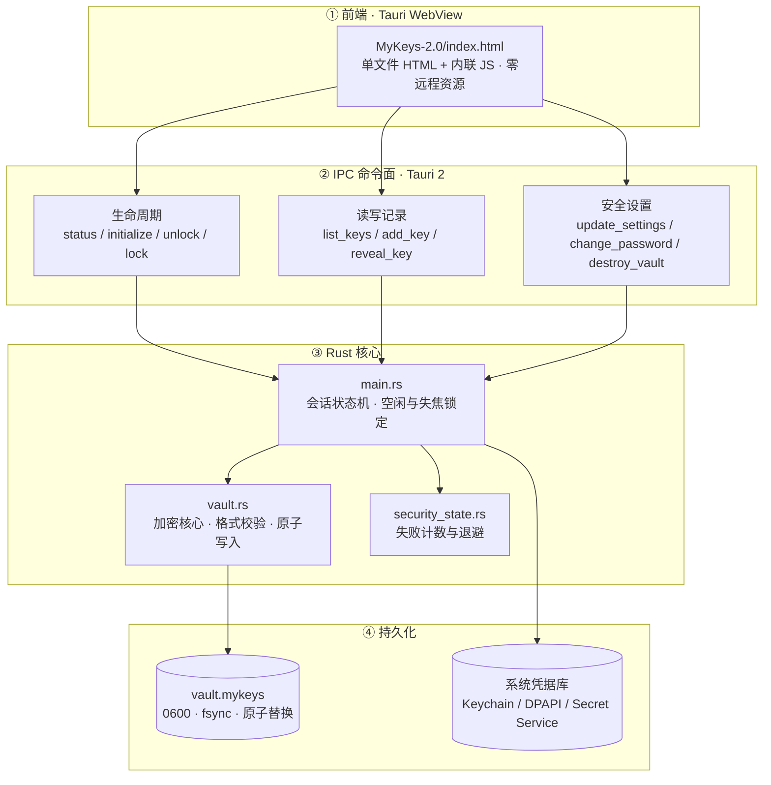
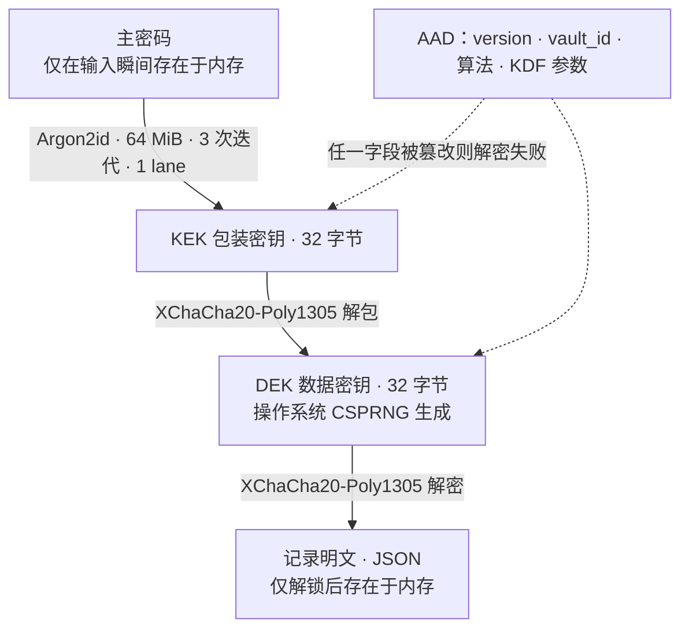
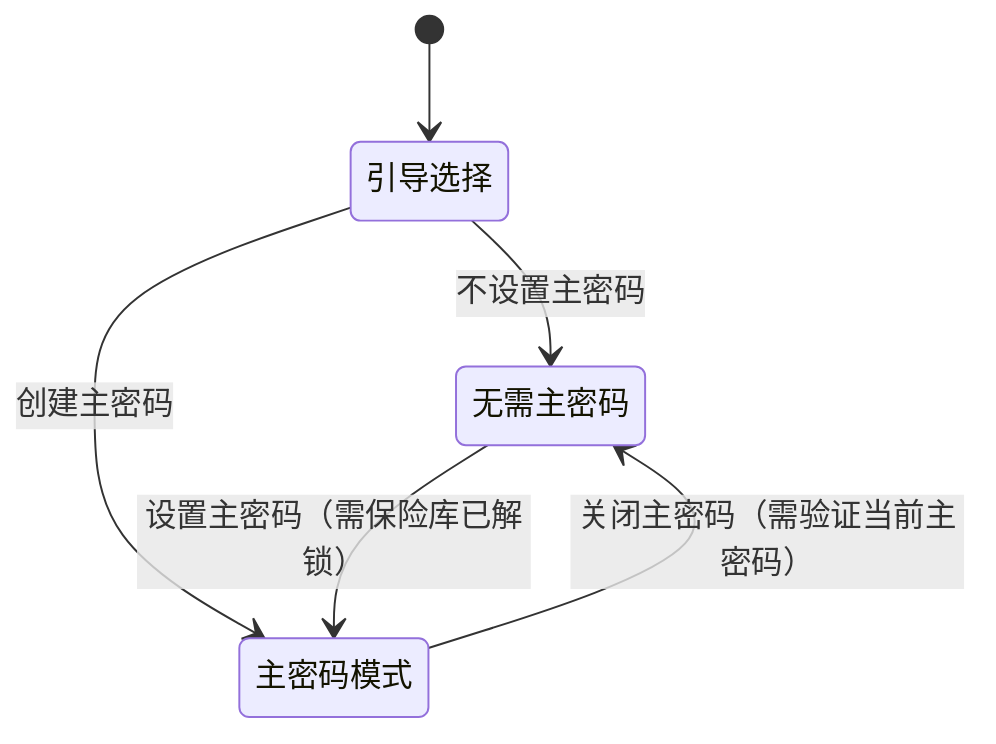
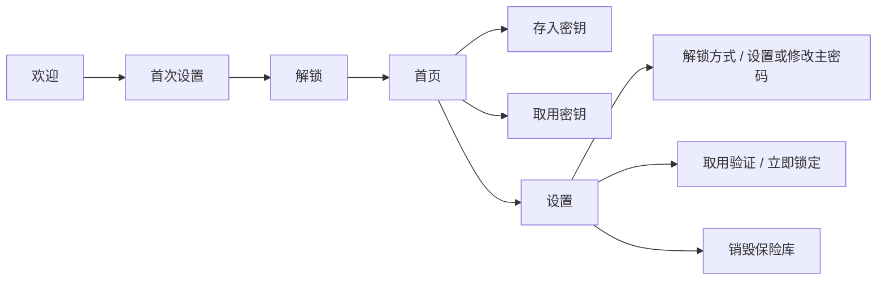

<div align="center">
  
  <h1>MyKeys</h1>
  <p><b>你的密钥，只在这里。</b><br>
  A local-first API key vault — no account, no cloud, no telemetry.</p>
  <p>
    
    
    
  </p>
</div>

MyKeys 把 API Key 加密保存在这台设备上。它不注册账号、不同步云端、不加载远程脚本与字体、不上报遥测，也不替你调用任何厂商接口。整个产品只把一件事做可靠：**安全地存下秘密，并在真正需要时快速、可控地取出。**

---

## 目录

- [架构总览](#架构总览)
- [加密设计](#加密设计)
- [解锁模式](#解锁模式)
- [IPC 命令面](#ipc-命令面)
- [数据落盘](#数据落盘)
- [界面流程](#界面流程)
- [构建与运行](#构建与运行)
- [验证](#验证)
- [安全边界](#安全边界)
- [项目结构](#项目结构)

---

## 架构总览

四层结构，上层不持有文件系统、Shell 或网络权限，所有敏感操作最终由 Rust 核心裁决。



**为什么这样切分。** 前端可以说不拥有任何真实能力——它只能发命令；会话状态、密码校验、文件读写全部在 Rust 侧，即使 WebView 被注入脚本，也拿不到绕过会话检查的接口。CSP 只允许一段带哈希的内联脚本，`build.rs` 在编译期断言哈希，改前端而忘记更新会被直接构建失败拦住。

---

## 加密设计

信封加密：主密码只保护数据密钥，数据密钥保护业务数据。因此**修改主密码只需重新包装 DEK，不必逐条重新加密任何一条 Key**。



| 项目 | 取值 |
| --- | --- |
| 密钥派生 | Argon2id，64 MiB 内存、3 次迭代、1 lane |
| 认证加密 | XChaCha20-Poly1305，24 字节随机 nonce，包装与数据使用不同 nonce |
| 附加认证数据 | 版本号、`vault_id`、算法名与 KDF 参数全部纳入 AAD |
| 格式版本 | `2`（`1` 仍可读，首次成功解锁时自动迁移） |
| 上限 | 5000 条记录、明文 20 MiB、文件 25 MiB、单条密钥 64 KiB |

`vault_id` 参与 AAD 的作用是让每一个保险库文件的认证标签都不同，避免攻击者用另一份合法文件替换头部字段。它不能阻止"整份旧快照回滚"——那是 AEAD 天生识别不了的事。

---

## 解锁模式

四种模式，安全强度从高到低。无论选哪种，**保险库文件始终是密文**，区别只在于数据密钥由谁来保管。

| 模式 | 打开时 | 数据密钥由谁保管 |
| --- | --- | --- |
| 每次启动 | 必须输入主密码 | 主密码派生的 KEK |
| 72 小时 | 72 小时内免密，到期强制重新验证 | 系统凭据，凭据带到期时间 |
| 系统凭据 | 免密打开 | 系统凭据，无到期 |
| 无需主密码 | 免密打开，不设主密码 | 系统凭据，且取用验证强制关闭 |



**「无需主密码」的实现代价被刻意压到最低。** 它不引入新的文件格式：关闭主密码时，DEK 会被一个新的随机口令重新包装，而该口令不写入任何位置——所以旧主密码会立刻失效。这样做的收益是格式、AAD 与 KDF 全部沿用原路径，风险面没有扩大。

**双向切换。** 「设置主密码」是显式恢复路径，但有一个不可回避的边界：它要求保险库当前已经解锁。系统凭据一旦被重置或设备更换，就无法再补救。

**取用验证。** 独立于启动解锁的开关，开启后显示或复制完整密钥前要再验证一次主密码，通过后获得 5 分钟授权。免密模式下该开关强制关闭——没有密码可验证。

---

## IPC 命令面

15 个命令，全部由 Rust 端重新校验会话与输入，前端无法绕过。

| 命令 | 作用 | 需要已解锁 |
| --- | --- | :---: |
| `status` | 读取初始化、解锁、模式与取用验证状态 | — |
| `initialize` | 创建带主密码的保险库 | — |
| `initialize_passwordless` | 创建无需主密码的保险库 | — |
| `unlock` | 主密码解锁 | — |
| `try_system_unlock` | 用系统凭据免密解锁 | — |
| `lock` | 清除当前会话 | — |
| `list_keys` | 列出记录（密钥只返回遮蔽值） | ✓ |
| `add_key` | 加密保存一条记录 | ✓ |
| `reveal_key` | 取出完整密钥明文 | ✓ |
| `authorize_retrieval` | 为取用验证建立 5 分钟授权 | ✓ |
| `update_settings` | 修改解锁模式与取用验证 | ✓ |
| `change_password` | 修改主密码（只重新包装 DEK） | ✓ |
| `clear_master_password` | 关闭主密码 | ✓ |
| `set_master_password` | 从免密模式补设主密码 | ✓ |
| `destroy_vault` | 销毁保险库，需输入确认文字 | — |

**连续失败会退避。** 解锁、取用验证、安全设置、修改主密码共用一个计数：第 3 次失败等 5 秒，第 4 次 30 秒，第 5 次起每次 5 分钟。计数持久化在磁盘上，重启不清零；系统时间被回拨时按完整等待时间处理。密码错误永远不会销毁数据。

---

## 数据落盘

```text
应用数据目录/
  vault.mykeys      格式头 + 被包装的 DEK + nonce + 业务密文与认证标签（0600）
  .vault.lock       排他文件锁，防止并发读改写丢记录
  security-state    连续失败计数与解锁时间（0600，带完整性标记）

系统凭据库/
  service: com.mykeys.vault
  account: local-vault
  内容：绑定 vault_id 的解锁凭据，按模式决定是否带到期时间
```

写入路径统一为：随机临时文件（显式 `0600`）→ `sync_all` → 同目录原子 `rename` → 同步目录。崩溃或写入失败都不会破坏上一份有效保险库。

---

## 界面流程



设置页可切换四种解锁模式、开关取用验证、改主密码、立即锁定、销毁保险库。销毁需要输入「删除全部数据」，并明确提示**不会撤销厂商侧仍然有效的 API Key**。

---

## 构建与运行

需要 Rust 工具链与 Node.js。

```sh
# 开发
cargo tauri dev

# 打包 macOS 应用
cargo tauri build --bundles app
```

本项目零前端构建步骤：`tauri.conf.json` 的 `frontendDist` 直接指向 `MyKeys-2.0`，前端就是一个 HTML 文件。

> **改前端前必读。** 内联脚本受 CSP 哈希约束，`build.rs` 会在编译期断言 `tauri.conf.json` 中的 `sha256-...` 与脚本正文一致，哈希过期会直接构建失败。取的是第一个 `<script>` 与第一个 `</script>` 之间的正文：
>
> ```sh
> python3 -c "import base64,hashlib;h=open('MyKeys-2.0/index.html',encoding='utf-8').read();s=h.split('<script>',1)[1].split('</script>',1)[0];print('sha256-'+base64.b64encode(hashlib.sha256(s.encode()).digest()).decode())"
> ```

---

## 验证

```sh
cargo fmt --check
cargo clippy --locked --all-targets --all-features -- -D warnings
cargo test --locked --all-targets
cargo build                # 触发 CSP 脚本哈希断言
```

测试覆盖：密文与头部篡改、错误主密码、明文缓冲清零路径、`0600` 文件权限、v1 → v2 迁移、免密保险库拒绝任意口令、取用验证与免密模式互斥、退避时间表与时间回拨、前端不以 HTML 方式插值保险库字段。

`.github/workflows/security.yml` 在 push、PR 与每周一执行上述检查，并附加 `cargo audit` 依赖漏洞扫描；Dependabot 每周检查 cargo 与 Actions 依赖。

---

## 安全边界

**能保护：** 被复制的保险库文件、磁盘上的明文残留、文件篡改、误操作暴露、离线暴力尝试的成本。

**不能保护，也不做承诺：** 已经被恶意软件控制的系统、以同账户身份运行的程序、内存转储、键盘记录、截图、第三方剪贴板历史工具、系统快照与备份副本、被重置的系统凭据库。

**免密模式会把安全边界整体转移到操作系统账户。** 能打开这台电脑的人，就能打开保险库——这是选择该模式时明确接受的取舍。一旦系统凭据被重置或更换设备，保险库无法恢复，没有任何后门、提示或云端找回。

界面不使用「军事级」「绝对安全」「无法破解」这类无法验证的措辞。删除本机保险库**不会**撤销厂商侧仍然有效的 API Key；如有泄露风险，请前往对应厂商撤销。

---

## 项目结构

```text
MyKeys/
├── src/
│   ├── main.rs                 IPC 命令、会话状态机、平台凭据
│   ├── vault.rs                加密核心、格式校验、原子写入
│   └── security_state.rs       失败计数与退避
├── MyKeys-2.0/
│   ├── index.html              单文件前端（界面与交互全部在此）
│   ├── assets/                 Logo 与厂商图标（构建时内置，运行时零请求）
│   ├── brand-spec.md           色板、字型与视觉禁区
│   └── MyKeys-2.0-产品设计文稿.md   产品与交互设计依据
├── 设计方案/
│   ├── MyKeys-设计方案-v1.md    第一版设计草案
│   ├── icons/                  各平台应用图标
│   └── providers/              厂商 Logo 源文件
├── build.rs                    编译期校验 CSP 脚本哈希
├── tauri.conf.json             窗口、CSP、打包配置
├── SECURITY.md                 漏洞报告方式
└── SECURITY_AUDIT.md           对抗式安全审查与修复记录
```

---

## 文档索引

| 文档 | 内容 |
| --- | --- |
| [MyKeys-2.0-产品设计文稿.md](MyKeys-2.0/MyKeys-2.0-产品设计文稿.md) | 产品定位、信息架构、交互规范、动效与无障碍、实施阶段 |
| [brand-spec.md](MyKeys-2.0/brand-spec.md) | 品牌资产、色板、字型、视觉禁区 |
| [SECURITY_AUDIT.md](SECURITY_AUDIT.md) | 威胁模型、离线攻击实测、逐条发现与修复状态 |
| [SECURITY.md](SECURITY.md) | 漏洞报告渠道与支持版本 |

---

## 安全报告

MyKeys 处理高价值凭据。报告问题时请**不要**附带真实 API Key、保险库文件、密码或包含秘密的截图，使用合成数据提供最小复现。详见 [SECURITY.md](SECURITY.md)。
